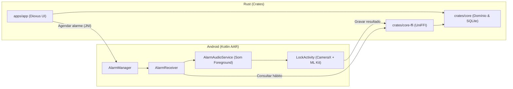

<p align="center">
  
</p>

<h1 align="center">CrabCheck</h1>

<p align="center">
  <strong>Despertador e Rastreador de Hábitos à Prova de Falhas para Estudo e Leitura</strong><br />
  <em>Pacto de Ulisses com Prova Visual (Câmara ao Vivo) e 100% Offline (SQLite Local)</em>
</p>

<p align="center">
  <a href="https://github.com/vitorpaiv4/CrabCheck/releases/latest"></a>
  
  
  
  
</p>

---

## 📖 Sobre o CrabCheck (About)

O **CrabCheck** é um aplicativo mobile criado para resolver um problema real: **a auto-sabotagem e a procrastinação nos hábitos diários de leitura e estudo**.

Muitas vezes configuramos alarmes comuns para estudar ou ler, mas acabamos por desligá-los no piloto automático ou adiá-los indefinidamente. O CrabCheck implementa o conceito de **Pacto de Ulisses**: quando o alarme toca, ele bloqueia o ecrã e só para quando você **se levantar, pegar o seu livro ou material e comprová-lo apontando a câmara do telemóvel**.

Além disso, o CrabCheck respeita integralmente a sua **privacidade e foco**: todo o funcionamento é **100% offline**, com os dados armazenados exclusivamente no seu aparelho via **SQLite**. Sem contas, sem envio de dados para servidores e sem anúncios.

---

## ⚡ Principais Funcionalidades

### 1. 🔔 Lembrete Prévio de 15 Minutos
* 15 minutos antes do horário marcado para leitura ou estudo, o telemóvel emite uma notificação preparatória.
* Dá-lhe o tempo necessário para organizar o ambiente e deixar o livro/material a postos antes do alarme rigoroso.

### 2. 📸 Validação Fotográfica Local (IA On-Device)
* Utiliza visão computacional local (**Google ML Kit**) com processamento em tempo real a 30 FPS diretamente no aparelho.
* Deteção afinada para itens do quotidiano como **Livros** (`Book`), **Garrafas** (`Bottle`), copos, calçado e portáteis.
* Inclui botão de alternância de lanterna para ambientes de baixa luminosidade.

### 3. 🔒 Alarme Rigoroso (Nível 3)
* Disparo em alta prioridade via `AlarmManager.setAlarmClock`.
* Ecrã de bloqueio em ecrã inteiro com toque contínuo que **não permite dispensar sem validação da prova fotográfica**.

### 4. ⏳ Proteção Anti-Sabotagem (Cooldown de 24h)
* Para evitar desistências impulsivas, qualquer tentativa de apagar, adiar ou reduzir a rigidez de um hábito Nível 3 entra num período de reflexão de 24 horas (com opção de forçar eliminação consciente se necessário).

### 5. 🛡️ 100% Offline & Privacidade Absoluta
* Nenhum dado sai do seu smartphone.
* Banco de dados local em SQLite (`crabcheck.db`) localizado no armazenamento interno protegido da aplicação.

---

## 🏗️ Arquitetura Técnica

O projeto adota uma arquitetura híbrida de alto desempenho que une a robustez do ecossistema **Rust** com os recursos nativos do **Android**:



* **`crates/core`**: Regras de negócio, cálculo de recorrência e persistência com `rusqlite` (único escritor do SQLite).
* **`crates/core-ffi`**: Interface C-ABI exportada automaticamente para Kotlin através do `uniffi`.
* **`apps/app`**: Interface gráfica reativa e moderna construída em Rust com **Dioxus**.
* **`android/alarm-lib`**: Biblioteca Android nativa responsável pelo `AlarmManager`, Foreground Service e visão computacional via `CameraX` + `ML Kit`.
* **`xtask`**: CLI de automação para compilar a pipeline, gerar bindings e construir o APK oficial.

---

## 📲 Como Instalar

Pode descarregar o APK oficial pronto a instalar diretamente na secção de Releases:

👉 **[Descarregar CrabCheck v0.1.0 (APK Oficial)](https://github.com/vitorpaiv4/CrabCheck/releases/latest)**

*Compatível com Android 8.0+ (API 26+) em dispositivos ARM64 e x86_64.*

---

## 🛠️ Comandos de Desenvolvimento

Para desenvolvedores que queiram compilar ou contribuir para o projeto:

```bash
# Executar todos os testes unitários em Rust
cargo test --workspace

# Verificar linting com Clippy
cargo clippy --workspace -- -D warnings

# Gerar bindings Kotlin via UniFFI
cargo run -p xtask -- bindgen

# Compilar a biblioteca Android (AAR) e rodar testes de integração JUnit
cargo run -p xtask -- build-aar

# Compilar o APK Release assinado e verificado
cargo run -p xtask -- release-apk
```

---

## 📄 Licença

Distribuído sob a licença MIT. Consulte `LICENSE` para mais informações.
