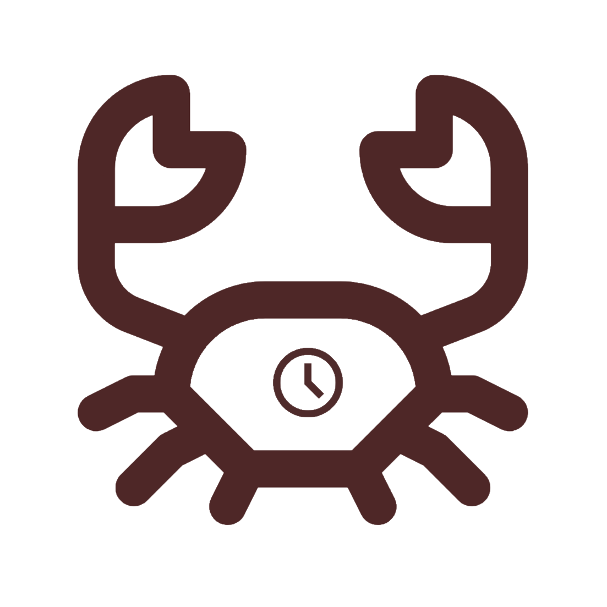

<p align="center">
  
</p>

<h1 align="center">CrabCheck</h1>

<p align="center">
  <strong>Agenda de Hábitos com Atrito Configurável e Prova de Ação Visual (Pacto de Ulisses)</strong><br />
  Construída com <em>Rust (Dioxus + SQLite + UniFFI)</em> e <em>Kotlin (Android AlarmManager + CameraX + ML Kit)</em>
</p>

Consulte:
- [contexto.md](contexto.md) — visão geral do produto e casos de uso.
- [docs/decisoes.md](docs/decisoes.md) — decisões arquiteturais, máquina de estados e roadmap.

## Estrutura do Repositório

- `crates/core` — Domínio e persistência local em SQLite (`rusqlite`), único escritor do banco.
- `crates/core-ffi` — Ponte UniFFI (`cdylib`/`rlib`) e binário `uniffi-bindgen` para geração de bindings Kotlin.
- `apps/app` — Aplicação UI multiplataforma em Dioxus (Android-first no MVP).
- `android/alarm-lib` — Biblioteca Android (AAR em Kotlin) responsável por `AlarmScheduler`, `AlarmReceiver` e `LockActivity`.
- `xtask` — Automação de geração UniFFI, compilação/testes da AAR, build Android via `dx` e patch do projeto Gradle gerado.

## Comandos Principais

```bash
# Executar testes unitários em Rust
cargo test --workspace

# Executar linter Clippy
cargo clippy --workspace -- -D warnings

# Gerar bindings Kotlin via UniFFI
cargo run -p xtask -- bindgen

# Compilar a AAR Kotlin e correr os testes JUnit (ida e volta Kotlin <-> UniFFI <-> SQLite)
cargo run -p xtask -- build-aar

# Pipeline completo Android (bindgen + AAR + dx build + patch Gradle/Manifest + assembleDebug APK)
cargo run -p xtask -- spike-android
```

O APK final gerado pelo `spike-android` fica em:
`target/dx/crabcheck-app/debug/android/app/app/build/outputs/apk/debug/app-debug.apk`
