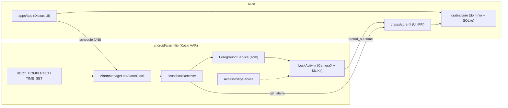
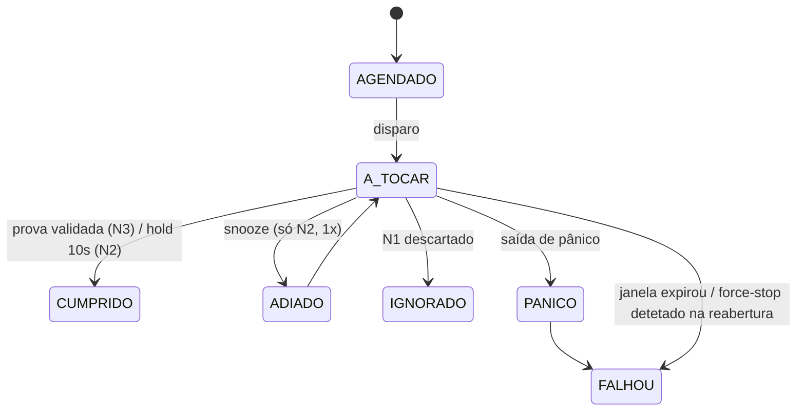

# CrabCheck — Decisões de Design (sessão de grilling)

Base: [contexto.md](../contexto.md)

## Decisões

| # | Tema | Decisão |
|---|------|---------|
| 1 | Plataforma | **Android-first**. Desktop/Web depois, só como cliente da timeline (sem alarmes intrusivos). |
| 2 | Backend no MVP | **Local-first**, 100% offline, SQLite no aparelho, sem login. Backend entra com o Contrato Social. |
| 3 | Fronteira Rust ↔ Android | **Híbrido**: o Kotlin trata todo o "momento do alarme" (AlarmManager, Receiver, Foreground Service, Activity de bloqueio, CameraX + ML Kit). O Rust/Dioxus trata a UI, os dados e o agendamento. |
| 4 | Dono dos dados | O crate Rust `core` é o **único escritor** do SQLite (rusqlite) e fica exposto ao Kotlin via **UniFFI** (`get_alarm`, `record_outcome`, `reschedule`). |
| 5 | Rigidez do N3 | **Bloqueio duro**, com distribuição por APK (fora da Play Store). |
| 6 | Mecanismo | **AccessibilityService** (devolve a Activity ao topo, fecha o painel de notificações e os recentes) + overlay `SYSTEM_ALERT_WINDOW`. Sem Device Owner. |
| 7 | Saída de emergência | A chamada de emergência é sempre permitida. Existe uma **saída de pânico**, registada como FALHOU. |
| 8 | Validação da prova | **Catálogo curado** de objetos → labels do modelo base do ML Kit. Confiança ≥ limiar em N frames seguidos, só com a câmara ao vivo (sem galeria). |
| 9 | Foto da prova | Guarda-se **1 frame JPEG de ~720p** em armazenamento privado, anexado ao registo. |
| 10 | Recorrência | **Hora fixa + dias da semana**, ou evento único. O `core` calcula o próximo disparo e o Kotlin agenda um único `setAlarmClock()` por hábito. |
| 11 | Snooze / estados | N3 sem snooze. N2 com 1× snooze de 5 min. N1 descartável. Estados: `CUMPRIDO`, `FALHOU`, `IGNORADO`. Janela de cumprimento por hábito (padrão 30 min); quando expira, o N3 termina e regista FALHOU. |
| 12 | Anti-batota | **Cooldown assimétrico de 24h**: tornar um N3 mais rígido vale de imediato; baixar o nível, apagar, mudar a hora ou o objeto só vale passadas 24h. Forçar paragem ou desligar a Acessibilidade durante um alarme ativo regista FALHOU. |
| 13 | Timeline (MVP) | Três tipos de entrada: hábito agendado, resultado (+ foto) e nota rápida em texto com `#tags`. Navegação por dia. Markdown fica para depois. |
| 14 | Build | **AAR Kotlin próprio** (`android/alarm-lib`) + `xtask` que, depois do `dx`, injeta a dependência Gradle e as entradas do Manifest no projeto gerado. **Spike primeiro.** |
| 15 | SDK / permissões | minSdk 29, targetSdk 35. **Onboarding obrigatório** por todas as permissões (alarme exato, full-screen intent, overlay, Acessibilidade, câmara, notificações, isenção de bateria). Sem elas não se criam hábitos N3. Um ecrã de "saúde" revalida as permissões ao abrir. |
| 16 | Preparação da fase 2 | **Supabase**. O schema já fica pronto para sync: IDs UUIDv7, timestamps UTC + fuso do hábito, `updated_at`, soft-delete com `deleted_at`, resultados append-only. |
| 17 | Mecânica de pânico | Contagem de 3 min com o som a tocar, depois escrever uma frase de compromisso. Máx. 2 por semana; a partir daí a contagem passa a 10 min. |
| 18 | Repositório | Cargo workspace: `crates/core`, `crates/core-ffi`, `apps/app` (Dioxus), `android/alarm-lib`, `xtask`. A lógica crítica tem testes unitários no `core`. |

## Arquitetura

## Máquina de estados de uma ocorrência

## Roadmap proposto

| Fase | Entregável |
|------|------------|
| 0 — Spike | Hello-world Dioxus Android + AAR injetado pelo `xtask` + chamada UniFFI ida e volta + `setAlarmClock` a abrir uma Activity Kotlin com o ecrã bloqueado. |
| 1 — Core | `core` com schema, recorrência, janela, cooldown, máquina de estados e testes. |
| 2 — Alarmes | N1/N2/N3, Foreground Service, reagendamento após reboot ou mudança de fuso, AccessibilityService, pânico. |
| 3 — Prova | CameraX + ML Kit, catálogo curado, limiar/N frames, gravação do frame. |
| 4 — UI | Timeline, CRUD de hábitos, notas, onboarding de permissões e ecrã de saúde. |
| Fase 2 do produto | Supabase, conta, sync, Contrato Social; depois Desktop. |

## Em aberto (decidir na implementação)

- Valores iniciais do limiar de confiança e de N frames (calibrar com testes reais por objeto).
- Lista inicial do catálogo (validar cada label no modelo base antes de a incluir).
- Como o N1 é contabilizado nas estatísticas futuras (IGNORADO conta como falha?).
- Tom da UI e idioma (pt-PT vs pt-BR, i18n).
